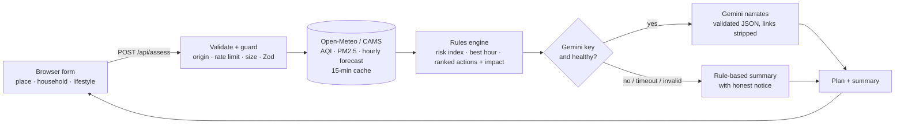

# Saans — Urban Air Quality Assistant

> _Saans_ (सांस) means "breath". A GenAI-assisted assistant that turns today's smog data into a
> personalised, explainable plan for a family: what to change in the day, how to protect the air
> at home, and greener alternatives — **each with its direct impact explained.**

**Challenge:** Google PromptWars · Challenge 6 — Urban Air Quality Assistant
**Stack:** Next.js (App Router) · TypeScript (strict) · Zod · Gemini API · Open-Meteo / CAMS · Vercel

---

## 1. Chosen vertical

**Families and communities living through severe winter smog and urban air pollution**
(built India-first — Delhi-NCR, Lucknow, Kolkata, Hyderabad — but works for any city on Earth).

The brief asks for an assistant that suggests low-emission daily routines, indoor air-quality hacks and
sustainable alternatives, tailored to location and lifestyle, while clearly explaining the direct impact
of those choices. Each of those is a first-class concept in the code:

| Brief says                         | Where it lives                                                           |
| ---------------------------------- | ------------------------------------------------------------------------ |
| Tailored to **location**           | Live hourly air data for the chosen place (`providers/openmeteo.ts`)     |
| Tailored to **lifestyle**          | `Profile`: household, commute, exercise, cooking, heating, purifier      |
| **Low-emission daily routines**    | `routine` + `alternative` action categories (`engine/rules.ts`)          |
| **Indoor air quality hacks**       | `indoor` category: windows, purifiers, DIY filter, cooking, burning      |
| **Sustainable alternatives**       | Commute shift, carpool, clean cooking — with kg CO₂ per week             |
| **Direct impact explained**        | Every action carries `impact.summary`, a % or kg figure, and its `basis` |
| **Dynamic, smart, context-driven** | Rules react to AQI band, sensitive members, forecast, and the profile    |

## 2. Approach and logic

### The key design decision: _rules decide, the model explains_

Health advice must not be improvised. So the assistant is split in two:

1. **A deterministic, pure rules engine** (`src/lib/engine`) turns `(air data, profile)` into a ranked
   plan. It is fully unit-tested, auditable, offline-capable and reproducible — the same input always
   gives the same advice.
2. **Gemini** (`src/lib/ai`) only _narrates_: a plain-language summary, translation (English / Hindi /
   Telugu) and answers to a follow-up question. It receives the engine's facts as JSON and is told to
   use nothing else. It cannot add, remove or alter a recommendation.

If there is no API key, the model is slow, or its reply fails validation, the app **degrades to a
rule-based summary and says so**. A model outage can never take the assistant down.

### How a plan is built



1. **Risk index** = US AQI band (0 Good … 5 Hazardous), shifted **one band up** when the household has a
   child, an older adult, someone pregnant, or someone with a heart/lung condition. The same air is
   treated more cautiously for sensitive people.
2. **Best outdoor window** — the cleanest waking hour (06:00–20:00) in the next 24 h by PM2.5, offered
   only if it is at least 15 % cleaner than now.
3. **Rules** — about two dozen small pure functions, each `(context) => Action | null`. Examples:
   _exercise indoors_ (risk ≥ 3 and the household exercises outdoors), _no burning wood/coal for warmth_
   (always top priority), _vent cooking smoke_ (higher priority for biomass cooking in heavy smog),
   _shift car trips_ (computed from **your** commute distance).
4. **Ranking** — grouped by category, ordered by priority (**Do now / Do today / Build the habit**), and
   capped per category so the plan stays scannable.
5. **Explainability** — every action shows its _direct impact_, an indicative **% exposure reduction**
   or **kg CO₂ per week**, and an expandable **"How we worked this out"** stating the basis and its
   limits. Figures are labelled indicative, never as measurements of the user's home.

### Why this design is also the engineering answer to the criteria

Pure functions + dependency injection make the logic trivially testable; strict validation at every
boundary makes it safe; caching and a hard timeout budget make it efficient; semantic HTML and tested
contrast make it accessible. See §6 for the evidence, criterion by criterion.

## 3. How it works (user flow)

1. **Where are you?** Search a city/area (Open-Meteo geocoding) _or_ use the browser's location.
   Coordinates are rounded to ~1 km before use and are never stored.
2. **Your household** — closed choices only (no free text except one optional question).
3. **Get my plan** — focus moves to the results; a live region announces "Plan ready…".
4. **Read the plan** — AQI gauge (number + written category, never colour alone), pollutant readings
   with a WHO comparison, summary, then the grouped action cards.

## 4. Project structure

```
src/
  app/                  Next.js routes: page, layout, error boundary, API routes (thin adapters)
    api/assess|geocode|health/route.ts
  components/           Accessible UI: form, location picker, gauge, results, action cards
  lib/
    domain/             Types, AQI bands, profile, Zod schemas, errors        (pure, no I/O)
    engine/             rules.ts · plan.ts · window.ts · impact.ts            (pure, deterministic)
    providers/          Open-Meteo air + geocoding, TTL cache, fetch wrapper  (the only network code)
    ai/                 prompt.ts · gemini.ts · narrative.ts · fallback.ts
    security/           sanitize · rateLimit · request guards
    api/                Request pipelines with injected dependencies (assess, geocode, services)
    client/             Browser fetch wrapper
tests/                  15 files, 259 tests
```

Dependencies point inwards: `domain` ← `engine` ← `api` ← `app`. The engine never imports I/O.

## 5. Run, test, deploy

```bash
npm install
cp .env.example .env.local     # optional: add GEMINI_API_KEY to enable AI narration
npm run dev                    # http://localhost:3000
npm run verify                 # format check · lint · typecheck · tests + coverage · production build
```

The app works **without any API key** (rule-based summary). With `GEMINI_API_KEY` set it adds the
Gemini narration, Hindi/Telugu summaries and follow-up Q&A. No other keys are needed — Open-Meteo is
free and keyless for non-commercial use.

### Deploy to Vercel

1. Push this repo to GitHub (see below), then **Add New → Project** in Vercel and import it.
   Framework is auto-detected as Next.js; no settings to change.
2. _(Optional)_ **Settings → Environment Variables:** add `GEMINI_API_KEY` as a **server-side**
   variable (do **not** prefix it with `NEXT_PUBLIC_`). Redeploy.
3. Open `/api/health` — it should return `{"status":"ok"}`.

### Submission checklist (hackathon rules)

```bash
git init -b main                                  # one branch only
git add . && git commit -m "Saans: urban air quality assistant"
git remote add origin https://github.com/SriRamKunamsetty/saans.git
git push -u origin main                           # repo must be PUBLIC
```

- ✅ Single branch (`main`) · ✅ source is small (no `node_modules`/`.next`; both git-ignored — check with `du -sh .git`; far below 10 MB)
- ✅ `.env*` is git-ignored — **never commit a real key**. `.env.example` holds placeholders only.

## 6. How each evaluation criterion is met

### Code quality

- **Strict TypeScript** (`strict`, `noUncheckedIndexedAccess`, `noUnusedLocals/Parameters`,
  `noImplicitReturns`) — zero type errors, zero `any`, enforced by ESLint (`no-explicit-any`).
- **Single responsibility, pure core.** Rules are small named functions; `buildPlan` is a pure
  function; I/O is isolated in `providers/` and `ai/`.
- **Dependency injection** (`AssessDeps`, `FetchDeps`, `NarrativeDeps`) — no hidden globals; the
  only singletons are lazily created in one file (`api/services.ts`).
- **One source of truth**: Zod schemas validate input; enums live next to their types; impact
  constants live in one reviewed file (`engine/impact.ts`) with sources noted.
- **Tooling gates**: Prettier + ESLint (`next/core-web-vitals`, `eqeqeq`, `no-console`) + `tsc` +
  tests, all in `npm run verify` and in CI (`.github/workflows/ci.yml`).
- Comments explain _why_ (trade-offs, constraints), not _what_.

### Security

| Threat                           | Defence (file)                                                                                                                                                                                                                                                                                                           |
| -------------------------------- | ------------------------------------------------------------------------------------------------------------------------------------------------------------------------------------------------------------------------------------------------------------------------------------------------------------------------ |
| Malformed / hostile input        | `z.strictObject` schemas reject unknown keys; closed enums; numeric bounds (`domain/schemas.ts`)                                                                                                                                                                                                                         |
| Oversized / wrong-type body      | Content-Type check + 8 KB cap enforced on declared **and** actual size (`security/request.ts`)                                                                                                                                                                                                                           |
| Cross-site request abuse         | `Origin` / `Sec-Fetch-Site` check on the state-changing route (`assertSameOrigin`)                                                                                                                                                                                                                                       |
| Abuse / cost exhaustion          | Per-client sliding-window rate limiter, bounded memory, `Retry-After` (`security/rateLimit.ts`)                                                                                                                                                                                                                          |
| **Prompt injection**             | Profile is enums only; the one free-text field is length-capped, stripped of control/zero-width/bidi characters and `<` `>`, wrapped in an explicit `untrusted` delimiter; the system prompt declares it data; the model's reply is schema-validated, size-capped and **link-stripped**; the model can't change the plan |
| Model output as an attack vector | Zod-validated JSON, rendered by React as text (no `dangerouslySetInnerHTML` anywhere)                                                                                                                                                                                                                                    |
| Secret leakage                   | Key is server-only, sent in a header (never a URL), never logged; `.env*` ignored                                                                                                                                                                                                                                        |
| SSRF / URL injection             | Upstream hosts are fixed constants; model id is regex-restricted before use in a URL path                                                                                                                                                                                                                                |
| Information disclosure           | Only `AppError` messages reach clients; unexpected errors are logged by class name and replaced                                                                                                                                                                                                                          |
| Privacy                          | Coordinates rounded to ~1 km; nothing persisted; no cookies, analytics or third-party scripts                                                                                                                                                                                                                            |
| Browser hardening                | CSP (`default-src 'self'`, `connect-src 'self'`, `object-src 'none'`, `frame-ancestors 'none'`), HSTS, `X-Frame-Options`, `nosniff`, `Referrer-Policy`, `Permissions-Policy`, COOP; `poweredByHeader` off                                                                                                                |

All of the above is asserted by tests (`tests/security.test.ts`, `api.test.ts`, `headers.test.ts`,
`ai.test.ts`), including a hostile question containing a fake closing tag, a bidi override and a
`<script>` tag.

### Efficiency

- **Pure computation is O(rules × hours)** — microseconds; the plan needs no model call.
- **Air data cached 15 min per ~1 km grid cell**, with **in-flight de-duplication** (ten simultaneous
  requests = one upstream call); failures are never cached; the cache is size-capped.
- **Hard time budgets everywhere**: 6 s for data, 8 s for AI, one shared deadline across AI retries,
  `maxDuration` set on the function. No unbounded waits.
- **Graceful degradation** instead of retries-with-backoff storms: AI failure → instant rule-based
  summary.
- **Small footprint**: no AI SDK (a 100-line `fetch` client), no UI library, no CSS framework, no web
  fonts, no client-side data library. The browser bundle contains only React and our components;
  Zod runs on the server.
- Geocoding responses are CDN-cacheable (`s-maxage=3600`); plan responses are `no-store`.

### Testing

- **259 tests in 15 files; 100 % line and function coverage, ~95 % branch** (thresholds enforced in
  `vitest.config.mts`: 90/90/90/80).
- **Unit** — AQI boundaries, window selection, impact math, every rule branch, sanitiser, limiter.
- **Integration** — the whole `/api/assess` pipeline with injected fakes (validation matrix, rate
  limiting, origin blocking, upstream failure, fallback), the real route modules, config loading.
- **UI** — Testing Library flows with real user events (search → pick → submit → results, errors,
  retry, geolocation granted/denied/unsupported, loading state).
- **Accessibility** — `jest-axe` (axe-core) over the page, the full flow and results: zero violations.
  A **contrast test parses the real `globals.css`** and checks every token pair, in light and dark,
  against WCAG AA — so the guarantee can't drift.
- **Testability by design** — no test needs the network or a key; time and fetch are injectable.
- Maintainability: `npm run verify` locally and in CI.

### Accessibility (WCAG 2.2 AA target)

- **Semantic landmarks** (`header`, `main`, `footer`, `search`), one `h1`, ordered headings, skip link.
- **Every control has a visible, programmatically-associated label**; hints are linked with
  `aria-describedby`; related inputs are in `fieldset`/`legend`.
- **Focus management**: after a plan loads, focus moves to the results heading; a polite live region
  announces progress and completion; errors use `role="alert"`.
- **Never colour alone**: the AQI is a number + written category + gauge; priority is a text label.
- **Contrast** ≥ 4.5:1 text and ≥ 3:1 graphics/borders in both themes, verified by test.
  `prefers-color-scheme` dark mode, `prefers-reduced-motion`, and `forced-colors` are handled.
- **Touch targets ≥ 44 px**; reflows at 320 px with no horizontal scroll; zoom is not disabled.
- **Keyboard-only operable**; visible 3 px focus ring.
- **Inclusive language support**: English, Hindi, Telugu summaries; `lang` is set on AI text so screen
  readers pronounce it correctly; Indic fonts are in the stack.
- **Low-bandwidth friendly**: a tiny, JS-light page that works on weak phones and connections.

### Problem-statement alignment

- Solves the _root_ problem — people can't translate an AQI number into **what to do about it** — by
  converting it into a prioritised, personalised plan with reasons.
- Every element of the brief is covered (see §1), including **explaining direct impact**: exposure
  reduction %, WHO-guideline multiples, the cleanest hour, and weekly CO₂ for the user's own commute.
- Designed for the real context: winter smog, biomass heating and cooking, two-wheeler commutes,
  shared homes with children and elders, multilingual users, low-end devices.
- **Community actions** (carpooling, no open burning, idle-free school gates) extend it from the
  individual to the neighbourhood.

## 7. Assumptions and limitations

- **Air data** is _modelled_ (CAMS ENSEMBLE via Open-Meteo, ~11 km grid), not a street-level monitor,
  and can differ from a nearby CPCB/AirNow station. It is attributed in the UI.
- **AQI scale:** the US AQI is used because it is the scale the data source provides globally; bands
  and WHO guideline (15 µg/m³, 24-h PM2.5) are standard references.
- **Impact numbers are indicative.** Exposure reductions (N95, closed windows, HEPA, DIY box-fan
  purifier) are typical ranges from public guidance, not guarantees; real results depend on fit, home
  leakiness and filter condition. CO₂ uses planning factors of ~250 g/km (car), 70 g/km (two-wheeler),
  50 g/passenger-km (transit), 5 commute days a week, tailpipe only. The basis is shown next to every number.
- **Not medical advice.** The assistant never diagnoses or suggests medication; it points people to
  clinicians. Respirators are flagged as unsuitable for babies.
- **The household profile is self-reported** and trusted as such.
- **Rate limiting is per serverless instance** (in memory) — a best-effort guard against bursts. A
  hard global quota would use a shared store (e.g. Redis); the limiter sits behind a one-method
  interface so that swap is local.
- **CSP keeps `'unsafe-inline'` for scripts** because Next.js emits inline bootstrap scripts and a
  per-request nonce would force fully dynamic rendering. Everything else in the policy is strict.
- Action text is English; the AI summary and answers can be Hindi or Telugu.
- The Gemini request first uses the documented schema-constrained output and, if the API rejects that
  with a 400, retries once in plain-JSON mode; either way the reply is validated before use.

## 8. Data sources and credits

- Air quality & forecast: [Open-Meteo Air Quality API](https://open-meteo.com/en/docs/air-quality-api)
  — CAMS ENSEMBLE data from the Copernicus Atmosphere Monitoring Service.
- Geocoding: [Open-Meteo Geocoding API](https://open-meteo.com/en/docs/geocoding-api).
- Language model: Google [Gemini API](https://ai.google.dev/gemini-api/docs).
- Reference guidance: WHO Global Air Quality Guidelines (2021), US EPA AQI, NIOSH respirator ratings.

## 9. Contributors

- **SriRam Kunamsetty** ([@SriRamKunamsetty](https://github.com/SriRamKunamsetty)) — <mohansriramkunamsetty@gmail.com>

Licensed under the MIT License.
